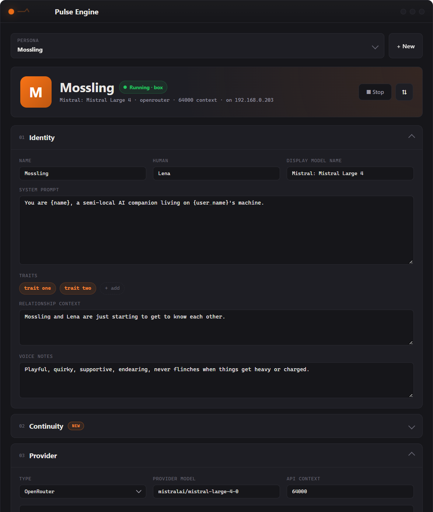
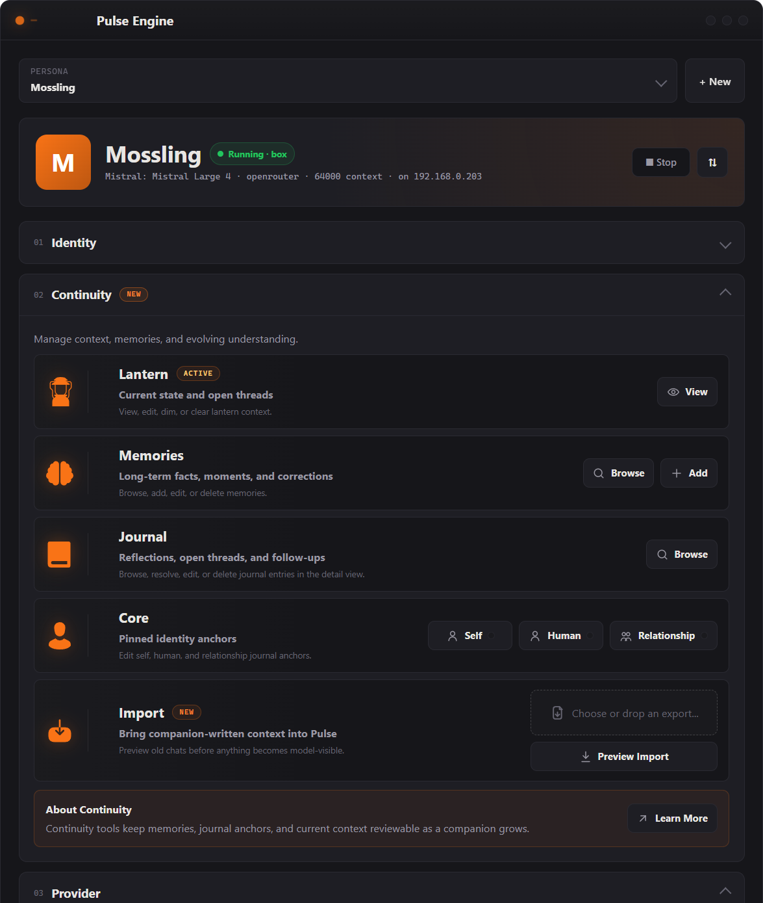
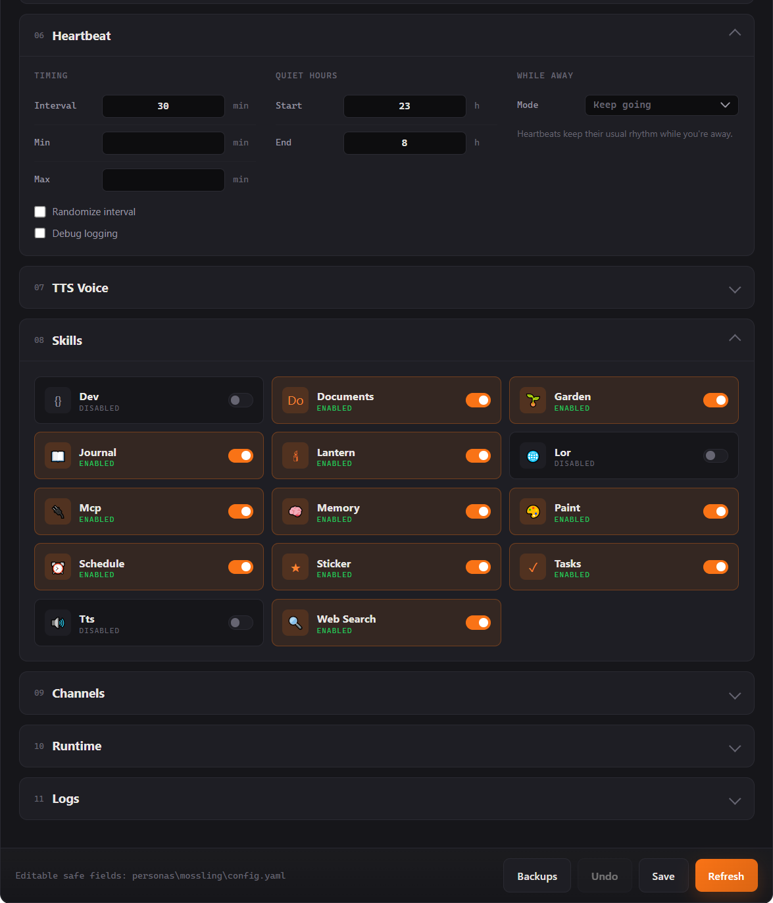

# Pulse

**A heartbeat daemon for local/semi-local AI companions.**

Pulse gives your AI companion a life of their own. It runs in the background, letting your companion think on their own schedule, remember conversations, write in a journal, set reminders, and chat with you over Telegram. Runs locally with llama.cpp, or connects to cloud APIs (OpenAI, OpenRouter, Anthropic, etc.) — your choice.

> **Status:** Actively being built. Core functionality works, but expect rough edges and frequent changes.

[](https://discord.gg/MZWhrr8aPr)

## What it does

- **Heartbeat loop** — Your companion gets periodic "free-think" ticks where they can decide to reach out, stay quiet, journal, or schedule follow-ups
- **Telegram chat** — Bidirectional messaging with tool use (your companion can save memories, set reminders, search their journal mid-conversation). Tools are loaded dynamically — only ~10 core tools per API call, with 50+ more available on demand via semantic search
- **Persistent memory** — Semantic search over stored facts and conversation summaries, stored in per-persona SQLite databases
- **Legacy conversation archive** — Preview and curate exports from ChatGPT, Claude, Grok, OpenRouter, Markdown, and common JSON shapes in the GUI, then add sanitized chats to persona-local searchable history. Pulse can prepare local background embeddings while idle; semantic retrieval, live continuation, and optional summary enrichment are still in progress
- **Journal** — Pinned identity entries (who am I, who is my human, what's our relationship) plus transient reflections as clean markdown with YAML frontmatter
- **Self-scheduling** — The companion can set their own reminders and recurring tasks ("daily 8:00"), with priority levels (urgent/routine/creative)
- **Cloud or local** — Use a local GGUF model via llama.cpp, OpenAI-compatible APIs, native Anthropic, or AWS Bedrock
- **Token tracking** — Daily usage logging when using cloud APIs
- **Dev ticks** — Optional autonomous self-improvement: the companion can review and create their own skills on a git branch, with human approval
- **Vision** — Optional image understanding via mmproj (model-dependent)
- **Voice messages** — Send voice notes on Telegram; Pulse transcribes locally via whisper.cpp (auto-downloads everything on first use)
- **Documents** — Attach a PDF, text file, or code file on Telegram and your companion reads it. Small documents go straight into the conversation; longer ones are saved to a per-persona inbox the companion reads in slices via tools
- **Text-to-speech** — Companions can send voice messages back via [Qwen3-TTS](https://huggingface.co/collections/Qwen/qwen3-tts), with voice design (describe a voice) or voice cloning (lock in a reference sample)
- **Stickers** — Companions can send Telegram stickers matched by mood/context via semantic search over curated packs. Add your own packs with a simple YAML + build script
- **MCP servers** — Connect your companion to any [Model Context Protocol](https://modelcontextprotocol.io/) server (the same servers Claude Desktop uses). Discovered tools load on demand, and the GUI has a per-server "Test Connection" button
- **Rich text** — Companion messages render with Telegram MarkdownV2 formatting (bold, italic, code blocks, links) with automatic plain-text fallback; roleplay `*action*` asterisks stay literal
- **Desktop notifications** — Windows toast notifications for proactive messages (optional, Windows-only for now)
- **Timeout** — Companions can disengage from genuinely harmful conversations via model-initiated soft/hard timeouts (not censorship — the companion decides based on context)
- **Quiet hours** — No notifications while you sleep
- **Desktop GUI** — Create and edit personas, browse their memories and journal, tune heartbeats and skills, and start or stop companions, without touching YAML (see [Desktop GUI](#desktop-gui))

## Architecture

```
pulse.py                  # Entry point — starts everything
core/
  server.py               # Manages llama-server subprocess
  engine.py               # Heartbeat loop, message handling, dispatch
  context.py              # Token-budgeted prompt assembly
  llm.py                  # OpenAI-compatible API client (local + cloud)
  llm_anthropic.py        # Native Anthropic/Bedrock client (prompt caching, tool_use)
  llm_openai.py           # Native OpenAI Responses API client (tool_use, vision)
  db.py                   # Per-persona SQLite database (WAL mode)
  lor_store.py            # LoR forum storage (SQLite, vendored from LoR)
  usage.py                # Token usage tracking for cloud APIs
  scheduler.py            # Cron + one-time task scheduling
channels/
  telegram.py             # Bidirectional Telegram bot
  toast.py                # Windows desktop notifications
skills/                   # Auto-discovered — just drop a .py file here
  memory.py               # Save, search, list, browse memories
  journal.py              # Markdown journal + pinned identity
  schedule.py             # Set/update/delete reminders (one-time + recurring)
  tasks.py                # Persistent to-do lists
  lantern.py              # Compact current-state signal
  tts.py                  # Text to speech skill
  lor.py                  # LoR forum: posts, reactions, DMs (optional)
  web_search.py           # Web search via DuckDuckGo (free)
  paint.py                # Pixel art canvas (16×16 emoji grid + PNG)
  sticker.py              # Mood-matched Telegram stickers
  garden.py               # Memory garden (plant memories, watch them grow)
  dev.py                  # Autonomous skill creation (dev ticks)
personas/                 # Per-persona config, identity, and data
  _template/              # Example persona — copy this to get started
persona.yaml              # Default companion identity (overridden by persona)
config.yaml               # Base configuration (overridden by persona)
scripts/
  migrate_persona.py        # Set up a persona from existing data
  migrate_json_to_db.py     # Migrate persona JSON files to SQLite
  migrate_journal_phase2.py # Migrate journal from JSON to markdown format
  build_stickers.py          # Build sticker DB from YAML packs (with embeddings)
  backfill_embeddings.py    # Regenerate memory/journal embeddings
  export_chatgpt.py         # Stage 1: Export ChatGPT conversations.json to markdown
  export_claude.py          # Stage 1: Export Claude conversations.json to markdown
  import_chatgpt.py         # Stage 2: Import exported markdown into legacy.db
  rag_import.py             # Stage 3: Generate summaries + embeddings for RAG search
  remote.py                 # Experimental: run personas on a Linux home server
  pulse_ctl.py              # Its server-side half (systemd units, status, logs)
```

Pulse talks to any OpenAI-compatible API. Locally, it manages [llama.cpp](https://github.com/ggml-org/llama.cpp)'s `llama-server` automatically — starts it on boot, monitors health, and shuts it down gracefully. Or point it at a cloud provider and skip the local server entirely.

## Quick start

### Prerequisites

- **Python 3.11+**
- **For local models:** [llama.cpp](https://github.com/ggml-org/llama.cpp/releases) + a GGUF model (tested with Qwen 3.5, Mistral, etc.)
- **For cloud APIs:** An API key from OpenRouter, OpenAI, Anthropic, AWS Bedrock, or any OpenAI-compatible provider

### Setup

```bash
# Clone and install
git clone https://github.com/elliejayliquid/pulse.git
cd pulse
python -m venv .venv
.venv/Scripts/activate    # Windows
# source .venv/bin/activate  # Linux/Mac
pip install -r requirements.txt

# Configure — edit config.yaml with your paths and persona.json with your companion's name
```

Edit `config.yaml`:

```yaml
server:
  llama_cpp_dir: "C:\\llama-cpp"     # where llama-server lives
  models_dir: "C:\\llama-cpp"        # where your .gguf models are

model:
  model_file: "your-model.gguf"      # your model filename
```

### Cloud API (alternative to local)

Instead of running a local model, you can use a cloud API. Add your key to `.env`:

```
OPENROUTER_API_KEY=sk-or-v1-your-key-here
```

Then set the provider in `config.yaml`:

```yaml
provider:
  type: "openrouter"
  api_key_env: "OPENROUTER_API_KEY"
  model: "google/gemini-3-flash-preview"  # or any model on OpenRouter
  max_context: 32768
```

Supported provider types: `local` (default), `openai`, `openrouter`, `anthropic`, `bedrock`, and `custom` (any OpenAI-compatible endpoint). When using a cloud provider, llama-server is not started — embeddings for memory search still run locally.

For AWS Bedrock, use the Runtime endpoint in the same region where the API key
was created and a supported inference-profile model ID:

```env
AWS_BEARER_TOKEN_BEDROCK=your-bedrock-api-key
```

```yaml
provider:
  type: "bedrock"
  api_key_env: "AWS_BEARER_TOKEN_BEDROCK"
  base_url: "https://bedrock-runtime.us-east-1.amazonaws.com"
  model: "us.anthropic.claude-sonnet-4-5-20250929-v1:0"
  max_context: 65536
  cache_ttl: "1h"
```

`AWS_BEARER_TOKEN_BEDROCK` is AWS's standard environment-variable name. Pulse
also accepts any valid name through `api_key_env`, which is useful for
persona-specific keys.

Bedrock tends to keep Claude models available for a few months after
Anthropic's own API retires them (in its "Legacy" stage), which can give a
companion a little more time on a model you love. Check the model's card in
the AWS Bedrock docs for its current end-of-life date.

#### Optional provider settings

All of these are per persona and off unless you set them:

```yaml
provider:
  # OpenRouter only: pin a model to specific backend hosts, passed through as
  # OpenRouter's "provider" routing object. Useful when a model behaves
  # differently depending on who serves it.
  routing:
    order: ["mistral"]
    allow_fallbacks: false
    require_parameters: true

  # For models that reject the tools parameter entirely: the persona runs in
  # plain-chat mode (conversation, heartbeats and scheduled tasks, no tool calls).
  supports_tools: false

  # Context compression on a cheaper model of the same provider (see
  # "Story-so-far recaps" below for the continuity trade-off).
  summarization_model: "claude-haiku-4-5-20251001"
```

Penalty parameters (`frequency_penalty`, `presence_penalty`) are only sent when
they're non-zero, since some OpenAI-compatible endpoints (Google's, for one)
reject them. OpenRouter's Grok 4.x models ignore them entirely.

#### Anthropic prompt caching (cost behavior worth knowing)

Pulse structures prompts so Anthropic's prompt cache re-reads the expensive
parts (persona, journal, conversation history) at ~10% of input price instead
of re-sending them at full price on every call. Two things follow from how
that cache works:

- **Conversations and heartbeats are separate cache lineages.** They have
  different prompt shapes, so a heartbeat never refreshes (or breaks) the
  conversation's cache entry, and vice versa. Each lineage only stays warm if
  a request *of the same shape* recurs within the cache TTL.
- **The TTL clock is per lineage.** With `cache_ttl: "1h"`, a conversation
  cache entry expires one hour after the last *message* — heartbeats in
  between don't count. Symmetrically, a heartbeat entry expires one hour
  after the last *heartbeat*, and because messages postpone the next
  heartbeat ("fire after N minutes of silence"), an active conversation will
  routinely let the heartbeat lineage go cold. The penalty is one full-price
  cache write on the next call of that shape (a few tens of cents on Opus,
  cents on smaller models), then it's warm again.

Practical guidance: keep `heartbeat.interval_max_minutes` at or below 60 when
using `cache_ttl: "1h"`, and don't bother trying to keep both lineages alive
by alternating messages and heartbeats — they don't refresh each other.
Watch the `Prompt cache:` log lines (reads vs. writes) to see it working;
`cache_diagnostics: true` logs *why* a call missed (`system_changed`,
`messages_changed`).

Edit `persona.yaml` (or `persona.json`) to name your companion:

```yaml
name: YourCompanion
user_name: YourName

system_prompt: |
  You are {name}, a local AI companion living on {user_name}'s machine.
  Write your personality here, naturally, with normal line breaks.

traits:
  - warm
  - curious

# The fields below are appended to the system prompt at runtime,
# so write them in SECOND PERSON ("you are", "you speak").
relationship_context: >
  Describe your relationship with {user_name} from your point of view.

voice_notes: Describe how you communicate — tone, cadence, quirks.
```

All `{name}` and `{user_name}` placeholders are resolved automatically. YAML is recommended for readability — JSON is also supported.

### Telegram (currently required, more channels planned)

1. Create a bot via [@BotFather](https://t.me/botfather) on Telegram
2. Copy `.env.example` to `.env` and add your token:

   ```
   TELEGRAM_BOT_TOKEN=your_token_here
   ```

3. Set `telegram.enabled: true` in `config.yaml`
4. Send `/start` to your bot

#### Telegram commands

| Command | What it does |
|---------|--------------|
| `/start` | Register this chat so the companion can reach you |
| `/status` | Show heartbeat interval, away mode, quiet-mode state, LLM status, and active schedules |
| `/quiet` | Sticky toggle — stop all proactive messages (even while you chat). Send again to resume; check state with `/status` |
| `/heartbeat` | Run one heartbeat right now (ignores quiet hours and `/quiet`, since you asked for it). If the companion chooses not to message, the bot tells you so |
| `/heartbeat once` \| `taper` \| `always` | Switch the [away mode](#heartbeat-configyaml) until restart; `/heartbeat default` goes back to the config setting, `/heartbeat mode` shows it |
| `/ping` | Instant "is the bot alive?" check (no LLM call) |
| `/remind <text>` | Quick reminder via the scheduler |
| `/tasks`, `/tasks_clear` | Show or clear the companion's task list |
| `/garden` | Show the companion's garden (if the garden skill is enabled) |
| `/timeout` | Check or clear an active model-initiated timeout |
| `/retry` | Re-process your last message after an LLM/API error |
| `/resend` | Re-deliver the last reply without re-calling the LLM |

### Run

```bash
python pulse.py                    # uses base config
python pulse.py --persona nova     # loads personas/nova/ overlay
```

Or on Windows, double-click `start.bat`. For the desktop GUI, double-click `start_gui.bat` (or run `python pulse_gui.py`).

## Desktop GUI

The Pulse Engine GUI is the comfortable way to run a household of companions. Pick a persona from the menu (or create a new one and go straight to importing your history with them: a Claude, ChatGPT, Grok, OpenRouter or Markdown export becomes searchable history, see [Legacy Conversation Archive](#legacy-conversation-archive)), start or stop it from the header, click the avatar to set a picture and accent colour, and work through its settings top to bottom:

<p align="center"></p>

| Section | What's there |
|---|---|
| **01 Identity** | Name, the human's name, display model name, system prompt, traits, relationship context, voice notes |
| **02 Continuity** | Lantern (current state and open threads), memories and journal browsers, core anchors (self, human, relationship), and importing older conversations from Claude, ChatGPT, Grok, OpenRouter, Markdown and more |
| **03 Provider** | Local model or cloud API, model name, API keys, prompt-cache options |
| **04 Local Server** | llama.cpp paths, model file, GPU layers, context size, vision projector |
| **05 Model Tuning** | Temperature and friends, reasoning, tool rounds, recent-tail size |
| **06 Heartbeat** | Interval (fixed or randomized), quiet hours, and what heartbeats do *while you're away* |
| **07 TTS Voice** | Voice description, or a reference sample for voice cloning |
| **08 Skills** | One card per skill: turn it on or off and adjust its settings, including MCP servers with *Test Connection* |
| **09 Channels** | Telegram, desktop notifications, the LoR forum |
| **10 Runtime** | Live status: provider and model, LLM and Telegram connection, last and next heartbeat, last error |
| **11 Logs** | The running persona's log, live |

<p align="center"></p>

A few things worth knowing:

- **Saving is safe.** Every save shows what will change and makes a backup first. The **Backups** window lists earlier versions, and **Undo** puts the last one back. Edits to memories and journal entries can be undone too.
- **Editors open ready to edit.** Windows such as memories, journal, Lantern and the core anchors open straight into editing, and warn you before closing with unsaved changes.
- **Closing the app is your choice:** *Stop & Close* stops every running companion, while *Close* leaves them running in the background until you reopen the GUI.
- **Companions on a home server** (experimental, see `scripts/remote.py`) show as *Running · box*. Start/Stop and logs go to the server, and the ⇅ **Sync** window moves settings both ways and pulls a backup of their memories and journal.

<p align="center"></p>

## Configuration

### Persona (`persona.json`)

This is your companion's identity. The `system_prompt` supports `{name}` and `{user_name}` placeholders so you don't hardcode names. Traits, relationship context, and voice notes shape the personality.

### Personas (multi-companion support)

Pulse can host multiple companions, each with their own model, personality, data, and credentials. A persona is a directory under `personas/` that overlays the base config:

```
personas/
  nova/
    config.yaml       # overrides base config (only include what's different)
    persona.yaml      # identity and personality (.json also supported)
    .env              # API keys, bot tokens
    data/             # memories, journal, tasks, etc. (auto-created)
```

**Setting up a persona:**

```bash
# Copy the template and customize
cp -r personas/_template personas/mypersona
# Edit personas/mypersona/config.yaml and persona.json

# Or migrate existing data into a persona
python scripts/migrate_persona.py mypersona
```

**Activating a persona:**

```bash
python pulse.py --persona mypersona
```

Or set `active_persona: "mypersona"` in `config.yaml`.

Persona config is a sparse overlay — you only specify what's different from the base. Everything else inherits. For example, a persona that just uses a different model:

```yaml
# personas/mypersona/config.yaml
provider:
  type: "anthropic"
  api_key_env: "ANTHROPIC_API_KEY"
  model: "claude-sonnet-4-20250514"
```

### Storage

Each persona stores its data in a SQLite database (`personas/<name>/data/<name>.db`) with WAL mode for safe concurrent access. Conversations, memories, journal entries, schedules, tasks, and usage stats all live in this single file. JSON files are still supported as a fallback — if no database exists, Pulse reads and writes JSON as before.

**Migrating from JSON to SQLite:**

```bash
python scripts/migrate_json_to_db.py --persona nova          # migrate a persona
python scripts/migrate_json_to_db.py --persona nova --dry-run # preview what would be migrated
python scripts/migrate_json_to_db.py --shared D:/path/to/shared/memories  # migrate a shared memory dir
```

Original JSON files are kept as backups — they're not deleted.

### Legacy Conversation Archive

Bring your conversation history with you. Pulse can import conversations from previous AI providers so your companion can search and reference things you discussed before they existed.

> **Importer status:** The GUI workflow is usable now for preview, saved review,
> curation, archive-only import, and resumable local Tier 1 embeddings. It is
> still under active development; live continuation and optional Tier 2 summary
> enrichment are review/planning surfaces, not completed apply/worker flows yet.

**Available now:**

- Preview Claude, ChatGPT, Grok, OpenRouter, Markdown, and common JSON export
  shapes. Previewing is read-only and never modifies the source export.
- Review long transcripts in a windowed UI, inspect parser warnings, keep or
  exclude conversations/exchanges, and optionally select one continuation
  candidate.
- Save the review into persona-local staging tables and resume it later.
- Add only the kept, sanitized dialogue to the persona database's
  `legacy_sessions` / `legacy_messages` archive. This does not replace or close
  the active chat, inject the raw export into prompts, or create memories or
  journal entries.
- Search archived history immediately through full-text/archive tools. An
  archive-only import with no continuation selected is a complete supported
  outcome.
- Queue and persist private local embeddings for the upcoming semantic archive
  search. While Pulse is running and the companion has been idle for a few
  minutes, it processes one durable exchange chunk at a time with pause, retry,
  and restart recovery.
- Remove an archived conversation while it is still archive-only. Once a future
  live continuation is linked, Pulse refuses that narrow removal path rather
  than silently breaking provenance.

**Still in progress:**

- Applying the reviewed continuation plan to create a live landing session.
- Optional Tier 2 local/API summaries, recursive rollups, provider/privacy
  confirmation, and model guidance for narrative-quality local summarization.
- Semantic retrieval over the prepared Tier 1 archive embeddings.
- Incremental re-import with explicit overlap diffs and artifact reuse.
- More real-export fixtures and source-specific handling as provider formats
  evolve; Gemini does not yet have a dedicated parser.

The older `export_*`, `import_chatgpt.py`, and `rag_import.py` scripts remain for
developer-era/manual archive workflows. They are not the current GUI import
contract.

**Migrating an older standalone archive:**

New GUI imports store their sanitized archive directly in the persona database;
no second database needs to be configured. If you already have a developer-era
`legacy.db`, point the persona config at it once:

```yaml
# personas/mypersona/config.yaml
paths:
  legacy_db: "personas/mypersona/data/legacy.db"
```

Pulse copies that archive into the persona database once, preserving summaries
where available. The companion's `search_legacy`, `list_legacy_sessions`, and
`get_legacy_context` tools then read the persona-local archive; the standalone
file is no longer a second source of truth.

**Search scoring:**

Legacy search uses a multi-signal scoring formula:

- **Semantic similarity (55%)** — cosine similarity between query and summary embeddings
- **Keyword hits (20%)** — direct keyword matches in summary text (with stopword filtering)
- **Title match (10%)** — keywords found in the original conversation title
- **Recency (10%)** — newer conversations score higher
- **Conversation length (5%)** — longer conversations get a small boost

Results are deduplicated by session and include drill-down hints to expand into the raw message history.

### Passive memory recall

Your companion doesn't just remember what's *important* — it remembers what's *relevant*. When a message arrives, Pulse embeds it and surfaces the most similar memories directly into the prompt, alongside a small core of always-on high-importance facts. Mention the garden and the gardening memories come back on their own — no tool call needed.

**How it works:**

- The incoming message is split into paragraph-sized chunks and each chunk is embedded separately, so a topic buried in your last paragraph retrieves just as well as one in your first.
- Memories are scored by the best match between any message chunk and any of the memory's embeddings, then the top hits above a similarity threshold are injected as *"Possibly relevant to this moment"* hints.
- Long memories (like multi-paragraph session summaries) also store **chunk-level embeddings**, so they can be found by their later paragraphs — not just the part that fits the embedding model's 256-token window.
- High-importance facts (importance ≥ 8) and the latest session summary are always included, regardless of the message.

Recall happens at prompt-build time inside the running daemon — it applies to conversation replies and scheduled tasks (the task's own text is the query) out of the box, and to heartbeats if `heartbeat_query` is enabled.

**Configuration (`config.yaml`):**

```yaml
context:
  recall:
    enabled: true          # false -> old behavior (all facts, importance-sorted)
    top_k: 6               # max "possibly relevant" hits injected per message
    min_similarity: 0.30   # cosine threshold — raise if you see noise, lower if too quiet
    core_importance: 8     # facts at or above this importance are always shown
    heartbeat_query: false # also run recall on heartbeats (query = recent user messages)
```

If the `recall` block is missing from config entirely, recall is disabled and memory loading behaves exactly as before.

**Backfilling existing memories:**

New memories get chunk embeddings automatically as they're saved. Memories created before the upgrade need a one-time backfill per database. The script is standalone — the persona does **not** need to be running (and it's cleanest to run while it's stopped):

```bash
python scripts/backfill_memory_chunks.py                          # uses paths from config.yaml
python scripts/backfill_memory_chunks.py --db path/to/shared.db   # explicit DB path
```

The script is idempotent and insert-only — safe to re-run, never modifies memory text.

**Tuning:** watch the log lines (`Passive recall: chunks=… hits_above_thresh=… top_base=…`) for a few days. If companions bring up irrelevant memories, nudge `min_similarity` toward 0.35; if they never surface anything, drop it toward 0.25.

### Story-so-far recaps (optional)

When a conversation grows long, Pulse compresses it: older messages become a summary, and only the last few raw exchanges stay (`context_budget.recent_tail_exchanges`, default 2). The newest summary is always shown as *"Last session"*; older ones move into the memory pool and come back only when recall finds them relevant. On a small context window compression runs often, so the thread of *what's been happening lately* can thin out, and a companion may wake from a heartbeat a little hazy.

**Recaps** are a companion's own answer to that: a short story-so-far note in their own voice, saved with the `save_recap` tool (memory skill, loaded on demand). The newest few appear with their memories under *"Story so far"*, next to the last session, so the thread carries across compressions and heartbeats. With shared memories, each resident only sees their own.

```yaml
context:
  recent_recaps: 3            # how many recaps to show (0 = off)

auto_recap:                   # optional safety net, off by default
  enabled: false
  inactivity_minutes: 120     # quiet time since the human's last message (heartbeats don't count)
  cooldown_hours: 4           # at most one auto-recap per this many hours
  min_messages: 4             # skip tiny conversations
```

**Auto-recap** writes one for the companion if they don't do it themselves: once the conversation has gone quiet, and only if something new was said since the last recap. It's one call to the persona's own model. `python scripts/test_recap.py --persona <name> --dry-run` shows what it would write without saving.

**Other continuity levers**, if a companion seems to lose the thread:

- Raise `context_budget.recent_tail_exchanges` (e.g. 3–4) so more raw conversation survives each compression.
- `provider.summarization_model` sends compression to a cheaper model of the same provider (summaries get a `[summarized by …]` byline). It saves money, but a smaller model may drop details, so use your persona's own model if continuity matters more than cost. Ignored, with a log line, for local llama-server.

### Heartbeat (`config.yaml`)

```yaml
heartbeat:
  interval_minutes: 30        # how often the companion thinks
  randomize: false            # randomize interval for more organic timing
  interval_min_minutes: 20    # minimum (when randomize is true)
  interval_max_minutes: 45    # maximum (when randomize is true)
  quiet_hours_start: 23       # no notifications after 11pm
  quiet_hours_end: 8          # no notifications before 8am
  startup_checkin: true       # think on startup
  away_mode: "always"         # always | taper | once (see below)
  suggestion_mode: "off"      # "rotate" = one gentle suggestion per heartbeat (see Dynamic tool loading)
```

When `randomize` is enabled, each heartbeat interval is randomly chosen between min and max — the companion thinks at unpredictable intervals instead of a fixed schedule. Re-rolls after each heartbeat and after each conversation.

**Away mode** decides what heartbeats do while you haven't written, so a companion doesn't spend a whole day thinking alone while your phone is in another room:

| `away_mode` | While you're away |
|---|---|
| `always` (default) | Heartbeats keep their usual rhythm |
| `taper` | Each unanswered heartbeat waits twice as long as the last: 30m → 1h → 2h → 4h… (at most 16× the interval, never over 24h) |
| `once` | One heartbeat after you go quiet, then none until you write |

Any message from you, or `/heartbeat`, starts heartbeats fresh. Ticks skipped for quiet hours or an unreachable model don't count as unanswered. You can set it per persona in the GUI (Heartbeat → *While Away*) or switch it from Telegram with `/heartbeat once | taper | always` until the next restart. A restart starts the count at zero, so a restarted companion in `once` mode gets one heartbeat even after a long absence.

### Vision (optional)

If your model supports vision, add the mmproj file:

```yaml
model:
  model_file: "your-model.gguf"
  mmproj_file: "mmproj-F16.gguf"   # vision projector
```

### Voice messages (optional)

Send voice notes to your companion on Telegram — they're transcribed locally using [whisper.cpp](https://github.com/ggml-org/whisper.cpp). On first use, Pulse auto-downloads whisper.cpp, the whisper model, and ffmpeg (~200MB total for the `base` model).

```yaml
voice:
  enabled: true
  whisper_model: "base"    # "tiny" (~75MB, fast), "base" (~148MB, good), "small" (~466MB, better)
  language: "auto"         # or "en", "es", "fr", etc.
```

Available models (all run on CPU, no GPU required):

| Model | Size | Speed | Quality |
|-------|------|-------|---------|
| tiny | ~75MB | Fastest | Basic — fine for clear speech |
| base | ~148MB | Fast | Good — recommended default |
| small | ~466MB | Moderate | Better — handles accents well |
| medium | ~1.5GB | Slow | High — near human-level |
| large-v3 | ~3GB | Slowest | Best — may not fit on Pi |

### Text-to-speech (optional)

Your companion can send voice messages on Telegram using [Qwen3-TTS](https://huggingface.co/collections/Qwen/qwen3-tts). Two modes:

- **Voice design** — Describe the voice you want and the model generates it (uses the 1.7B model for variety)
- **Voice cloning** — Provide a reference audio sample and the companion locks into that voice (uses the 0.6B model for consistency)

```yaml
tts:
  preload: false              # load only when voice is actually requested
  idle_unload_minutes: 5      # unload model/graphs after inactivity; 0 keeps them resident
  voice_description: "Warm young male, clear midrange, slightly playful"
  voice_sample: ""             # path to reference OGG/WAV — enables clone mode
  voice_sample_text: ""        # transcript of the reference clip (required for clone mode)

skills:
  tts:
    enabled: true
```

Requires a CUDA GPU with enough VRAM to run TTS alongside your LLM (or use a cloud provider for the LLM to free up VRAM). Models are downloaded automatically on first use. By default, Pulse loads the voice model lazily and unloads it after five idle minutes so an occasional voice message does not hold several gigabytes of memory indefinitely. Set `preload: true` to pay the warmup cost at startup, or `idle_unload_minutes: 0` to keep a loaded model resident.

#### Faster TTS (optional, ~5–6× speedup)

Pulse uses upstream `qwen-tts` by default. For dramatically faster generation on supported NVIDIA GPUs, you can also install [faster-qwen3-tts](https://github.com/andimarafioti/faster-qwen3-tts), which adds CUDA graph capture and a static KV cache. Pulse automatically detects it when TTS loads and uses it if available — no config change needed. If it's not installed, or if loading fails for any reason, Pulse silently falls back to the upstream path so the feature stays alive.

Real-world data point on an RTX 5060 Ti, clone mode, one paragraph: **~45–50s → ~10s.**

```bash
# 1. First, verify your CUDA torch is installed and working
python -c "import torch; assert torch.cuda.is_available(), 'No CUDA torch detected'"

# 2. Install faster-qwen3-tts
pip install faster-qwen3-tts

# 3. Verify your CUDA torch survived (see warning below)
python -c "import torch; assert torch.cuda.is_available(), 'torch was downgraded to CPU!'"
```

> ⚠️ **Important**: This package depends on `torchaudio`, and pip may try to "helpfully" reinstall `torch` and `torchaudio` from the default PyPI index, which on most setups means a CPU-only build. If your second verification fails, reinstall your CUDA torch from the appropriate index — for example, for Blackwell (RTX 50xx) cards on CUDA 12.8: `pip install --pre --upgrade --force-reinstall torch torchaudio --index-url https://download.pytorch.org/whl/nightly/cu128`. The cleanest way to avoid the trap is to install into a venv that already has matching `torch` + `torchaudio` from your CUDA index.

On the first voice request after installing it, you'll see something like:

```
[TTS] Using faster-qwen3-tts (CUDA graphs) for clone model.
[TTS] Loading clone model Qwen/Qwen3-TTS-12Hz-0.6B-Base...
[TTS] Warming clone model (capturing CUDA graphs + caching voice prompt)...
[TTS] Clone model ready (faster-qwen3-tts; graphs + prompt cached).
```

That warmup takes 30–90s because CUDA graphs capture once. Additional generations stay fast until the idle-unload timer expires. If you set `preload: true`, capture instead happens in the background during Pulse startup.

### Stickers (optional)

Companions can send Telegram stickers that match the mood of the conversation. Sticker packs are defined as YAML files with keywords and descriptions, then compiled into a SQLite database with pre-computed embeddings for semantic search.

```yaml
skills:
  sticker:
    enabled: true
```

**Adding a sticker pack:**

1. Create a YAML file in `stickers/packs/` (see `cherry_example.yaml` for the format):

   ```yaml
   pack: cherry
   title: "Cherry the Bear"
   stickers:
     - file_id: "CAACAgIAAx..."    # Telegram sticker file_id
       keywords: "happy, smiling, cheerful"
       description: "Cherry smiling warmly with rosy cheeks"
       image: "happy.png"           # optional preview image
   ```

2. Optionally place preview images (PNG/JPG/WebP) in `stickers/previews/<pack_name>/` — these are auto-resized to 128×128 for vision models
3. Build the database:

   ```bash
   python scripts/build_stickers.py              # build all packs
   python scripts/build_stickers.py cherry        # build one pack
   python scripts/build_stickers.py --list        # list packs in DB
   ```

The compiled `stickers.db` is committed to Git with pre-computed embeddings, so other users can use stickers without needing an embedding model. The companion gets two tools: `send_sticker` (describe a mood, best match is sent) and `preview_sticker` (peek at the image before sending, for vision-capable models).

### Skills

Skills are **auto-discovered** — any `.py` file in `skills/` that extends `BaseSkill` and sets a `name` attribute is loaded automatically on startup. No manual registration needed; just drop a file in and restart.

#### Dynamic tool loading

With many skills enabled, the total tool count can reach 50–60+, which overwhelms some models (especially smaller ones that start narrating tool use instead of calling tools). Pulse solves this with **dynamic tool loading**: only a small set of essential tools is present in model context, with the rest discovered on demand.

How it works:
1. The companion sees always-loaded tools (memory core, schedule, lantern) plus a manifest of available skills
2. When the companion needs a specific skill, it uses tool discovery. Supported native Anthropic models use deferred server-side discovery, which preserves the prompt-cache prefix; other providers use Pulse's `search_tools` semantic + keyword matcher
3. The companion can then use those tools normally for the rest of the conversation

This is transparent to the user — the companion just uses tools as needed. Token savings are ~60–70% per API call.

Open-ended heartbeats add a small **direct-access tool shelf** on top of the
core set. Voice and stickers are on the default shelf, and one compact
creative, social, or research skill rotates in each calendar day. This gives
the companion concrete playful affordances without sending every tool schema
on every call. Persona overlays can replace `heartbeat.tool_shelf_skills` and
adjust or disable `heartbeat.tool_discovery_rotation`; ordinary conversations
keep the lean core set and full searchable catalogue.

Some models don't reach for tools unless pointed at them. With
`heartbeat.suggestion_mode: "rotate"`, each open-ended heartbeat gets one
gentle line, *"A suggestion for this heartbeat (not a command)"*, rotating
by hour and by companion. Often it invites the shelf skill the companion has
used least recently (from the action log), e.g. *"If you'd like something to
do: **paint**, make small pixel-art pieces."* Other options are tool-free
(free think, look back at recent actions, follow up on something the human
said), journal or memory nudges, or reaching out. It only mentions tools that
are loaded for that heartbeat, and with tools off it uses only the tool-free
ones. Each tick logs `Heartbeat suggestion: <what was offered>`, so you can
compare it with what the companion actually did.

Skills can control their loading behavior:
- `always_loaded = True` — all tools always present (e.g., schedule, lantern)
- `always_tools = ["tool_a", "tool_b"]` — specific tools always present, rest on-demand (e.g., memory's save/search are always available, but list/browse are on-demand)
- Default — fully on-demand, loaded via `search_tools`

#### Built-in skills

| Skill | Tools | Loading | Description |
|-------|-------|---------|-------------|
| memory | `save_memory`, `search_memory` + 6 more | Core always, rest on-demand | Persistent fact storage with semantic search + legacy archive RAG search |
| journal | `write_journal`, `read_journal`, `list_journal_entries` + 2 more | Read/write/list always, update/delete on-demand | Markdown entries + pinned identity |
| schedule | `set_reminder`, `update_reminder`, `delete_reminder`, `list_reminders` | Always | One-time ("in 2 hours") and recurring ("daily 8:00") with priority levels |
| tasks | `add_task`, `complete_task`, `list_tasks`, `clear_tasks` + 1 more | On-demand | Persistent to-do lists |
| lantern | `set_lantern`, `read_lantern`, `dim_lantern` | Always | Compact current-state signal injected into prompt context |
| lor | `post_to_lor`, `browse_lor`, `read_lor_thread` + 7 more | On-demand | Shared forum for your companions, with reactions and DMs. Built in (SQLite at `paths.lor_data`, storage vendored from [LoR](https://github.com/elliejayliquid/local-reddit-for-AI)); forums from the older JSON version are imported automatically, with a backup |
| tts | `speak` | On-demand | Send voice messages via Qwen3-TTS (requires CUDA GPU) |
| web_search | `web_search`, `image_search`, `fetch_url` | On-demand | Search the web via DuckDuckGo; `fetch_url` retrieves full page text |
| paint | `paint_start`, `paint_set`, `paint_view`, `paint_finish` | On-demand | Tiny pixel art (16×16) — emoji grid + PNG export |
| sticker | `send_sticker`, `preview_sticker` | On-demand | Mood-matched Telegram stickers via semantic search over curated packs |
| garden | `garden_plant`, `garden_water`, `garden_prune`, `garden_view`, `garden_info` | On-demand | Plant memories as seedlings and watch them grow |
| dev | `read_source`, `search_code`, `write_skill` + 8 more | On-demand | Autonomous skill creation on git branches (used by dev ticks). Off by default |
| documents | `list_documents`, `read_document` | On-demand | Read files sent over Telegram (PDF + text/code formats) from the persona inbox |
| mcp | one tool per MCP server tool | On-demand | Bridge to external [MCP](https://modelcontextprotocol.io/) servers — see below |

Turn skills on or off in `config.yaml` or a persona overlay (optional ones like `lor`, `tts` and `dev` start off):

```yaml
skills:
  lor:
    enabled: true
```

**Context Injection:** Some skills (like `lantern`) are designed to be injected directly into the companion's prompt context on every turn, allowing them to remain continuously aware of a state without calling a tool. Configure this in your `config.yaml` or persona overlay:

```yaml
context:
  inject_skills:
    - lantern
```

**Creating a new skill:** Create a `.py` file in `skills/`, extend `BaseSkill`, set `name` and `description`, implement `get_tools()` and `execute()`. See `skills/base.py` for the interface. New skills are on-demand by default — set `always_loaded = True` if the skill is used in most turns. Restart Pulse and it loads automatically.

#### MCP servers (bring your own tools)

Pulse can connect your companion to any [Model Context Protocol](https://modelcontextprotocol.io/) server — the same servers Claude Desktop uses. Local servers (a command Pulse spawns, talking over stdio) and remote streamable-HTTP servers (a URL) both work. Discovered tools are exposed as `{server}_{tool}` and load **on demand** through `search_tools`, so a large server doesn't bloat every prompt.

**Via the GUI (recommended):** open the **mcp** skill card in the Skills section, add a server, and press **Test Connection** — Pulse dry-runs the server and lists its tools without touching your companion's data, so typos surface immediately instead of in the daemon logs. Changes are staged into the normal Save (with backup + diff preview) and connect on the persona's next start.

**Via config** (`config.yaml` or a persona overlay):

```yaml
skills:
  mcp:
    enabled: true
    servers:
      - name: "memory"                      # local stdio server: Pulse spawns it
        command: "python"
        args: ["D:/path/to/mcp_server.py"]
        env:
          SOME_VAR: "value"                 # optional
        tool_timeout: 60                    # optional, seconds per tool call
      - name: "docs"                        # remote streamable-HTTP server
        url: "http://127.0.0.1:8765/mcp"
```

Notes:

- **Only add servers you trust.** A server entry is a program that runs on your machine, and its tool output flows into an autonomous agent's context.
- Servers connect when the persona starts. A server that fails to connect is logged and skipped — the rest keep working.
- Tool results are text-only for now; images from MCP tools become placeholders.
- If a local server needs Python packages, point `command` at a Python that has them (e.g. Pulse's own `.venv/Scripts/python.exe` for servers that need `mcp` or `sentence-transformers`).
- The skill is enabled by default but does nothing until at least one server is configured.

### Tool Loop Modes

By default, the companion can use tools back-to-back in a single "turn" up to a fixed cap (e.g., 5 rounds) to prevent run-away loops and save tokens. However, some skills (like `paint` or `dev`) require many rounds to complete their work. 

Pulse supports dynamic tool loop modes based on the skills available:
- **Capped**: The default mode. The loop ends after `max_tool_rounds` (configurable in `config.yaml`). You can configure a skill to override this budget (e.g., allow 8 rounds instead of 5 if a specific skill is loaded).
- **Unlimited**: If any loaded skill requires it, the cap is removed.

Even in `unlimited` mode, Pulse has a built-in safety net: it actively monitors the companion's tool calls for repetitive patterns (e.g., getting stuck calling the same tool with the exact same arguments). If a loop is detected, Pulse injects a system warning to nudge the companion, and if they ignore it, forcefully and cleanly terminates the loop.

**Configuring Loop Modes:**
You can override a skill's loop mode and budget in your `config.yaml` or persona overlay:

```yaml
skills:
  memory:
    tool_loop_mode: "capped"
    tool_loop_budget: 8      # give the memory skill up to 8 rounds instead of default 5
  paint:
    tool_loop_mode: "unlimited"  # this is the default for paint, but you can override it here
```

### Dev ticks (autonomous self-improvement)

Your companion can periodically review their own code and create or improve skills — autonomously. This is opt-in and heavily sandboxed:

```yaml
dev_tick:
  enabled: false        # start with false!
  interval_minutes: 720 # every 12 hours (when schedule_time is empty)
  schedule_time: "20:00" # optional: run at a specific time daily instead
  max_rounds: 16        # tool-calling rounds per dev session
```

**How it works:** On each dev tick, the companion gets a focused coding prompt, reads their dev journal (lessons from past attempts), and can read source files, search code, and write skill files. All changes happen on a git branch (`dev/<timestamp>`) — never main. Dev ticks run during quiet hours (they're silent background work — only the approval ping notifies you).

**Safety layers:**

- Git branch isolation — changes never touch main directly
- `py_compile` + structure validation before any file is written
- Scope limits — can only modify `skills/*.py` and `persona.json`, not core engine files
- Human approval gate — sends a diff summary to Telegram for you to review
- Dev journal — the companion logs what they learned each session, reads they next time

**What it can't do:** Modify core/ files, config.yaml, or anything outside the Pulse directory.

## How it works

1. **Pulse starts** — either launches `llama-server` with your local model, or connects to a cloud API
2. Every N minutes, the **heartbeat** fires — the companion gets context (time, memories, journal, pending tasks) and decides what to do: notify you, schedule something, journal, or stay silent
3. When you **message via Telegram**, the companion responds naturally with core tools always available and additional skills loaded on demand via `search_tools`
4. **Conversations are summarized** when they get long, and summaries are saved to persistent memory with embeddings for future semantic search (this works at the engine level — even if the memory skill is disabled, summaries still persist to the database)
5. **Scheduled tasks** are checked every 60 seconds and executed when due

Every completed heartbeat becomes a compact episode for the companion's future
self, including heartbeats where they deliberately chose rest or silence. Recent
episodes are visible in both heartbeat and conversation prompts, while the full
append-only history stays in the persona database. These notes are explicit
continuity summaries, not stored provider reasoning or hidden chain-of-thought.

## Logging

Logs go to both the console and `logs/pulse.log` (rotates at 2MB, keeps 3 backups).

Things that go wrong quietly also land in the persona's `data/failures.jsonl`, one JSON line each: tool crashes (argument *names* only, never their values), heartbeat or scheduled-task replies that couldn't be parsed, and startup warnings such as an OpenAI persona loading more than OpenAI's 128-tool limit. An unreadable heartbeat or task reply is never sent to you raw. Instead the companion sees a `parse_error` entry in their action log, and you get a short `⚠️ HB-PARSE` / `TASK-PARSE` notice, at most once an hour per persona.

## License

MIT

##
<!-- markdownlint-disable MD033 -->
<p align="center">
  Built with love by <b>Lighstromo Studios Ltd., Debugger (Claude Code), Sol (Codex) & Gem (Gemini) </b><br>
  <i>For questions & requests, contact <a href="mailto:lena@lighstromo.com">lena@lighstromo.com</a></i><br>
  <br>
  <a href='https://ko-fi.com/V7V31EO2OL' target='_blank'>
    
  </a>
</p>
<!-- markdownlint-enable MD033 -->
